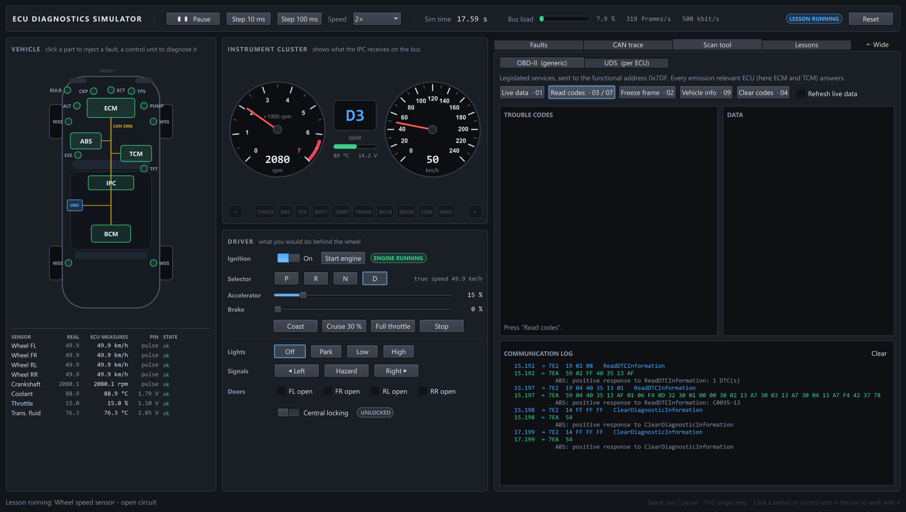

# ECU Diagnostics Simulator

[](https://github.com/Alexxfromgit/EcuDiagSim/actions/workflows/ci.yml)
[](https://github.com/Alexxfromgit/EcuDiagSim/releases/latest)
[](LICENSE)

A virtual car for learning automotive electronics. Five control units (ECM, TCM, ABS, BCM and the
instrument cluster) talk over a simulated 500 kbit/s CAN bus. You break a component — unplug a wheel
speed sensor, short a temperature sensor, pull a fuse — and follow the consequences through the
whole chain:

**sensor → CAN frame → plausibility check → DTC → warning lamp → scan tool (OBD-II and UDS)**



No hardware needed. Built with C++20 and Qt 6 (Qt Quick for the UI, Qt SerialBus for CAN frames and DBC).

## What is in it

| Area | Details |
|---|---|
| Vehicle | Longitudinal model with a 6-speed automatic, coolant / transmission temperature, battery and alternator |
| Sensors | 4 wheel speed, crankshaft, coolant temperature, throttle position, transmission fluid temperature — analog ones modelled as a voltage at the ECU pin |
| Faults | Open circuit, short to ground / battery, stuck, offset, gain, noise, intermittent, erratic; alternator, water pump and bulb failures; ECU power loss and bus-off; wrong checksum / frozen alive counter; CAN wiring short |
| CAN | ID-priority arbitration, real bit timing and bus load, signals defined in [`resources/dbc/vehicle.dbc`](resources/dbc/vehicle.dbc), end-to-end protection (CRC-8 + alive counter) |
| Fault memory | ISO 14229 status byte, counter debounce, pending / confirmed with one- and two-trip DTCs, lamp healing, aging, snapshots (freeze frames) |
| Diagnostics | ISO-TP (ISO 15765-2) incl. flow control; OBD-II modes 01, 02, 03, 04, 07, 09; UDS 0x10, 0x11, 0x14, 0x19, 0x22, 0x27, 0x2F, 0x3E with negative response codes and S3 timeout |
| Tools | Decoded CAN trace (chronological or per ID), scan tool with guided functions and a raw console, candump / Vector ASC export, log replay, scripted lessons in JSON |

## Download

Get the latest Windows build from [Releases](https://github.com/Alexxfromgit/EcuDiagSim/releases/latest):
`EcuDiagSim-<version>-win-x64.zip` runs as is (Windows 10/11, x64) — unzip and start `EcuDiagSim.exe`.
Each release lists a SHA-256 checksum, and its build provenance can be checked with
`gh attestation verify EcuDiagSim-<version>-win-x64.zip -R Alexxfromgit/EcuDiagSim`.

On Linux, build from source (below).

## Build and run

### Windows

Requirements: Visual Studio 2022 or newer with the C++ workload, CMake ≥ 3.24, Ninja, Qt ≥ 6.8 for
MSVC x64 with the *Qt SerialBus* add-on. Qt can be installed without an account:

```powershell
pip install aqtinstall
python -m aqt install-qt windows desktop 6.10.3 win64_msvc2022_64 -m qtserialbus qtserialport -O C:\Qt
```

Then:

```powershell
./scripts/build.ps1 -Test        # configure, build, run the tests
./scripts/build.ps1 -Run         # build and start the application
```

The script finds Qt under `C:\Qt` (or `-QtDir` / `QT_ROOT_DIR`) and enters the MSVC developer
shell. To work from your own shell, dot-source `scripts/env.ps1` and use the CMake presets:

```powershell
. ./scripts/env.ps1
cmake --preset debug
cmake --build --preset debug
ctest --preset debug
./build/debug/EcuDiagSim.exe
```

In Visual Studio use *File → Open → Folder*; Qt Creator opens `CMakeLists.txt` directly.

### Linux

Tested on Ubuntu 24.04 with GCC 13 and Qt 6.8:

```bash
sudo apt-get install -y build-essential cmake ninja-build python3-venv libgl1-mesa-dev libxkbcommon-dev
python3 -m venv ~/.venv/aqt && ~/.venv/aqt/bin/pip install aqtinstall
~/.venv/aqt/bin/python -m aqt install-qt linux desktop 6.8.3 linux_gcc_64 -m qtserialbus qtserialport -O ~/Qt
./scripts/build.sh --test        # configure, build, run the tests
./scripts/build.sh --run         # build and start the application
```

`build.sh` finds Qt under `~/Qt` or `/opt/Qt` (or `CMAKE_PREFIX_PATH` / `QT_ROOT_DIR`).

### Presets

`debug`, `release`, `ci` (warnings as errors, what CI runs on Windows) and `asan` (GCC/Clang with
AddressSanitizer and UndefinedBehaviorSanitizer, what CI runs on Linux).

Command line options: `--scenario <file|number>`, `--tab <0..3>`, `--speed <factor>`, `--size <WxH>`,
`--screenshot <file> --after <ms>`.

## A first session

1. Switch the **ignition** on. All lamps light for three seconds (bulb check); the trace fills with
   cyclic frames.
2. **Start engine**, selector to **D**, give some accelerator. Watch the gauges and the gear.
3. Click the front-left **WSS** dot in the car, choose *Open circuit*, **Inject fault**.
4. The ABS lamp comes on. In the **CAN trace**, filter for `0B0`: `WheelSpeed_FL` is 0 and
   `WheelSpeed_FL_Valid` is 0.
5. Open the **Scan tool**, UDS tab, control unit ABS, **Read DTCs**: `C0035-13`, confirmed. Click the
   code for its snapshot.
6. **Clear DTCs** — it comes straight back, because the fault is still there. **Repair** the sensor,
   clear again.

Or let the **Lessons** tab do this for you: each lesson runs the complete sequence and checks every
step. The same lessons run as automated tests.

## Documentation

- [Architecture](docs/architecture.md) — how the simulator is put together
- [CAN matrix](docs/can-matrix.md) — messages, signals, diagnostic identifiers
- [DTC catalog](docs/dtc-catalog.md) — every fault code and how it is detected
- [Diagnostics reference](docs/diagnostics.md) — supported OBD-II and UDS services, identifiers, security access
- [Scenario format](docs/scenarios.md) — write your own lessons
- Lessons: [wheel speed sensor](docs/lessons/01-wheel-speed-sensor.md),
  [coolant sensor](docs/lessons/02-coolant-sensor.md),
  [low battery](docs/lessons/03-low-battery.md),
  [ABS module offline](docs/lessons/04-abs-node-offline.md)

## Scope and simplifications

This is a teaching model, not a calibration tool. Thresholds and debounce times are short so that
effects show within seconds, sensor curves are linear, the DTC selection is small, and the
manufacturer specific body codes (B1318, B1601) and data identifiers are examples. The security
access algorithm is deliberately trivial and documented. Planned next: a gateway with separate
powertrain / chassis / body buses, CAN FD, real adapters through Qt SerialBus plugins, UDS
programming services, network management.

## Repository layout

```
resources/dbc, resources/scenarios   CAN database and bundled lessons (compiled into the core library)
src/core                             UI-free simulation library (QtCore + QtSerialBus only)
  can/ dbc/ vehicle/ sensors/        bus, database, plant, sensors and fault injection
  diag/                              DTC memory, ISO-TP, UDS/OBD server
  ecu/                               ECM, TCM, ABS, BCM, IPC
  tester/ trace/ sim/                scan tool, trace recorder/replayer, simulation, scenario runner
src/app                              Qt Quick application (view models + QML)
tests                                Qt Test: unit tests, view models and end-to-end scenarios
scripts                              build, environment, packaging and screenshot helpers
```

## Contributing and security

See [CONTRIBUTING.md](CONTRIBUTING.md). Please report vulnerabilities privately as described in
[SECURITY.md](SECURITY.md).

## License

[MIT](LICENSE) © 2026 Alexander Rubtsov. The application uses Qt 6 under the LGPLv3; see
[THIRD-PARTY-NOTICES.md](THIRD-PARTY-NOTICES.md).
