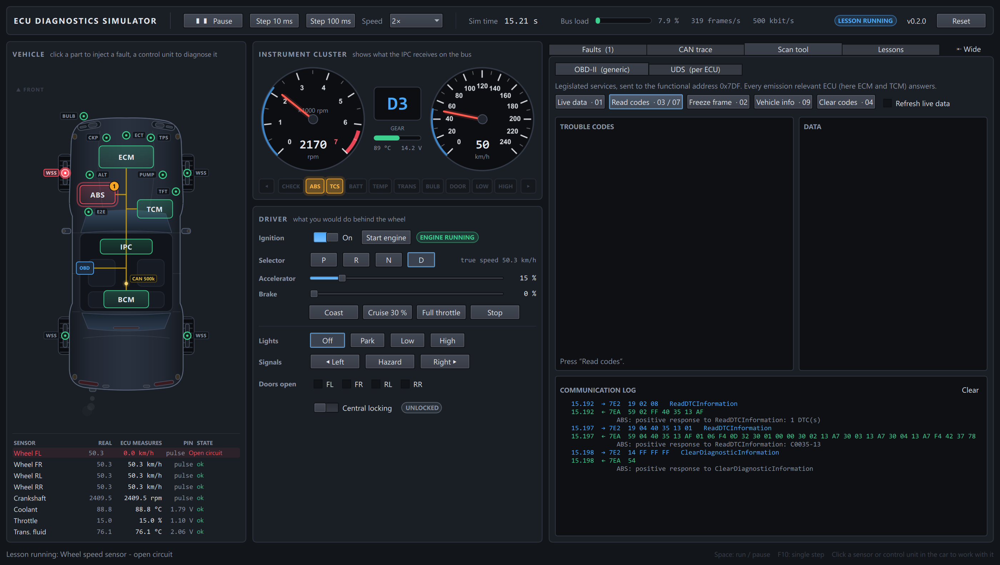

# ECU Diagnostics Simulator

[](https://github.com/Alexxfromgit/EcuDiagSim/actions/workflows/ci.yml)
[](https://github.com/Alexxfromgit/EcuDiagSim/releases/latest)
[](LICENSE)

A virtual car for learning automotive electronics. Five control units (ECM, TCM, ABS, BCM and the
instrument cluster) talk over a simulated 500 kbit/s CAN bus. You break a component — unplug a wheel
speed sensor, short a temperature sensor, pull a fuse — and follow the consequences through the
whole chain:

**sensor → CAN frame → plausibility check → DTC → warning lamp → scan tool (OBD-II and UDS)**



No hardware needed. Built with C++20 and Qt 6 (Qt Quick for the UI, Qt SerialBus for CAN frames and DBC).

## What is in it

| Area | Details |
|---|---|
| Vehicle | Longitudinal and lateral model (steering, yaw, understeer, per-wheel brake slip on dry / wet / snow / ice) with a 6-speed automatic and a park brake, coolant / transmission temperature, battery and alternator, fuel tank with consumption and overrun cut-off, oil pressure; trip computer in the cluster |
| Sensors | 4 wheel speed, crankshaft, coolant temperature, throttle position, oil pressure, fuel level, transmission fluid temperature; optional mass air flow and oxygen sensor, optional TPMS radio sensors in the wheels, optional airbag squibs and belt buckle switch, optional steering angle and yaw rate sensors — analog ones modelled as a voltage at the ECU pin |
| Faults | Open circuit, short to ground / battery, stuck, offset, gain, noise, intermittent, erratic; alternator, water pump, oil pump and bulb failures, stuck park brake switch; replaced parts without coding or adaptation; ECU power loss and bus-off; wrong checksum / frozen alive counter; CAN wiring short |
| CAN | ID-priority arbitration, real bit timing and bus load, signals defined in [`resources/dbc/vehicle.dbc`](resources/dbc/vehicle.dbc), end-to-end protection (CRC-8 + alive counter) |
| Fault memory | ISO 14229 status byte, counter debounce, pending / confirmed with one- and two-trip DTCs, lamp healing, aging, snapshots (freeze frames) |
| Diagnostics | ISO-TP (ISO 15765-2) incl. flow control; OBD-II modes 01, 02, 03, 04, 07, 09; UDS 0x10, 0x11, 0x14, 0x19, 0x22, 0x27, 0x2E (coding), 0x2F, 0x31 (routines), 0x3E with negative response codes and S3 timeout |
| Tools | Decoded CAN trace (chronological or per ID), scan tool with guided functions and a raw console, candump / Vector ASC export, log replay, thirty-two scripted lessons in JSON |

## Download

Get the latest version from [Releases](https://github.com/Alexxfromgit/EcuDiagSim/releases/latest):

| Platform | Installer | Portable |
|---|---|---|
| Windows 10/11 (x64) | `EcuDiagSim-win-x64-Setup.exe` | `EcuDiagSim-win-x64-Portable.zip` |
| macOS 12+ (Apple silicon) | `EcuDiagSim-osx-arm64-Setup.pkg` | `EcuDiagSim-osx-arm64-Portable.zip` |
| macOS 12+ (Intel) | `EcuDiagSim-osx-x64-Setup.pkg` | `EcuDiagSim-osx-x64-Portable.zip` |
| Linux (x64, glibc 2.39+: Ubuntu 24.04, Debian 13, Fedora 40 or newer) | `EcuDiagSim-linux-x64.AppImage` (runs as is: `chmod +x`, then start it) | |

The installer needs no administrator rights (Windows installs into your user profile, with a
Start menu entry). The portable builds run from any folder.

**Updates:** installed and portable copies check for a new release about ten seconds after they
start, download it in the background and offer to restart into it; otherwise it installs at the
next start. Turn the automatic check off, or check by hand, in the version menu at the top right.
Version 0.1.0 predates this and has to be replaced by hand once.

`SHA256SUMS.txt` on each release lists the checksums of every file, and every file's build
provenance can be checked with `gh attestation verify <file> -R Alexxfromgit/EcuDiagSim`. The
builds are not code-signed yet: Windows SmartScreen asks you to confirm ("More info" → "Run
anyway"), and macOS needs right-click → Open the first time.

## Build and run

### Windows

Requirements: Visual Studio 2022 or newer with the C++ workload, CMake ≥ 3.24, Ninja, Qt ≥ 6.8 for
MSVC x64 with *Qt SerialBus*. The 3D viewer also uses *Qt WebEngine*, *Qt WebChannel* and
*Qt Positioning* (a WebEngine dependency). Qt can be installed without an account:

```powershell
pip install aqtinstall
python -m aqt install-qt windows desktop 6.10.3 win64_msvc2022_64 -m qtserialbus qtserialport qtwebengine qtwebchannel qtpositioning -O C:\Qt
```

Then:

```powershell
./scripts/build.ps1 -Test        # configure, build, run the tests
./scripts/build.ps1 -Run         # build and start the application
```

The script finds Qt under `C:\Qt` (or `-QtDir` / `QT_ROOT_DIR`) and enters the MSVC developer
shell. To work from your own shell, dot-source `scripts/env.ps1` and use the CMake presets:

```powershell
. ./scripts/env.ps1
cmake --preset debug
cmake --build --preset debug
ctest --preset debug
./build/debug/EcuDiagSim.exe
```

In Visual Studio use *File → Open → Folder*; Qt Creator opens `CMakeLists.txt` directly.

The build downloads the [Velopack](https://velopack.io) C library (for in-app updates) on the first
configure; `-DECUSIM_UPDATES=OFF` builds without it.

### Linux

Tested on Ubuntu 24.04 with GCC 13 and Qt 6.8:

```bash
sudo apt-get install -y build-essential cmake ninja-build python3-venv libgl1-mesa-dev libxkbcommon-dev libegl1 libfontconfig1 libdbus-1-3 libnss3 libxcomposite1 libxdamage1 libxrandr2 libxtst6 libxkbfile1 libasound2t64
python3 -m venv ~/.venv/aqt && ~/.venv/aqt/bin/pip install aqtinstall
~/.venv/aqt/bin/python -m aqt install-qt linux desktop 6.8.3 linux_gcc_64 -m qtserialbus qtserialport qtwebengine qtwebchannel qtpositioning -O ~/Qt
./scripts/build.sh --test        # configure, build, run the tests
./scripts/build.sh --run         # build and start the application
```

`build.sh` finds Qt under `~/Qt` or `/opt/Qt` (or `CMAKE_PREFIX_PATH` / `QT_ROOT_DIR`).

### 3D vehicle MVP

Use **3D** in the vehicle column, then **Expand** for a larger workspace. Hold the left mouse
button and drag to orbit, scroll to zoom, and click markers to inspect sensors or controllers.
The inspector opens the existing fault controls and UDS scanner. Diagnostic/exterior modes,
system and fault filters, camera presets, live values and equipment changes work offline.

The modern four-door sedan has curved body panels, wheel openings, separate glazing, alloy wheels,
and slim lights. The fitted Engine OBD, TPMS, SRS and ESC packs add their physical components,
markers and connections. Diagnostic mode shows solid sensor/CAN wiring and dashed TPMS radio
paths with animated signal pulses. Flow respects pause, reduced motion and panel visibility;
**Wiring** and **Data flow** can also be switched off. CAN pulses follow newly transmitted frames;
routing, sensor sampling pulses and display timing are illustrative. Doors, steering, wheels,
position/dipped/high lamps, indicators/hazards, brake and reverse lamps follow simulator state.

The exterior adapts **Gourami - Luxury Saloon** by **Fishboe/ministephen**, via sevnworks,
under **CC BY 4.0**, with attribution shipped in the app. The viewer code remains MIT.
Component locations and harness routes are approximate. The viewer uses bundled Three.js
under MIT and LGPL Qt modules, without Qt Quick 3D. **Diagram** preserves the original view.
Configure with `-DECUSIM_VEHICLE_3D=OFF` to omit WebEngine entirely. If its Qt modules are absent,
the build falls back to the diagram with a CMake warning. Software-rendered Qt sessions default
to the diagram. Launch with `--vehicle-3d` to open the expanded viewer directly.

See [3D viewer development](docs/vehicle-3d.md) for architecture, tests, dependencies and limitations.

### Presets

`debug`, `release`, `ci` (warnings as errors, what CI runs on Windows) and `asan` (GCC/Clang with
AddressSanitizer and UndefinedBehaviorSanitizer, what CI runs on Linux).

Command line options: `--scenario <file|number>`, `--tab <0..3>`, `--speed <factor>`, `--size <WxH>`,
`--settings` (open the settings page), `--uds <0..3>` (scan tool in UDS mode on ECM / TCM / ABS / BCM),
`--screenshot <file> --after <ms>`.

The app opens **paused** at 0 s: nothing happens on the bus until you press **Run** (or Space).
**Settings** (⚙ in the top bar, or Ctrl+,) can change that, set the speed the app starts with, reduce
motion, and fit optional equipment to the vehicle. Lessons and `--scenario` always start by themselves.

The window adapts to the screen: it opens no larger than the available desktop and works down to
1024×600. Below 1200 pixels of width the vehicle view is hidden by default (**Show car** brings it
back), and narrow panels stack or scroll instead of clipping.

## A first session

1. Switch the **ignition** on. All lamps light for three seconds (bulb check); the trace fills with
   cyclic frames.
2. **Start engine**, selector to **D**, give some accelerator. Watch the gauges and the gear.
3. Click the front-left **WSS** dot in the car, choose *Open circuit*, **Inject fault**.
4. The ABS lamp comes on. In the **CAN trace**, filter for `0B0`: `WheelSpeed_FL` is 0 and
   `WheelSpeed_FL_Valid` is 0.
5. Open the **Scan tool**, UDS tab, control unit ABS, **Read DTCs**: `C0035-13`, confirmed. Click the
   code for its snapshot.
6. **Clear DTCs** — it comes straight back, because the fault is still there. **Repair** the sensor,
   clear again.

Or let the **Lessons** tab do this for you: each lesson runs the complete sequence and checks every
step. The same lessons run as automated tests.

## Lessons

| # | Lesson | Level | You learn |
|---|---|---|---|
| 1 | [Wheel speed sensor, open circuit](docs/lessons/01-wheel-speed-sensor.md) | Beginner | the whole chain from sensor to scan tool, UDS snapshots |
| 2 | [Coolant sensor, open circuit](docs/lessons/02-coolant-sensor.md) | Beginner | pull-up circuits, substitute values, OBD-II modes 02/03/09 |
| 3 | [Alternator failure](docs/lessons/03-low-battery.md) | Beginner | one root cause, DTCs in several ECUs |
| 4 | [ABS module offline](docs/lessons/04-abs-node-offline.md) | Intermediate | lost communication U-codes, knock-on faults |
| 5 | [Throttle sensor, limp home](docs/lessons/05-throttle-limp-home.md) | Beginner | limp home strategy, circuit low / high |
| 6 | [Crankshaft sensor, stall and no start](docs/lessons/06-crankshaft-no-start.md) | Beginner | cranks-but-no-start diagnosis with live data |
| 7 | [Water pump failure, overheating](docs/lessons/07-overheating.md) | Beginner | driver warning versus stored DTC |
| 8 | [Transmission fluid sensor](docs/lessons/08-trans-fluid-sensor.md) | Intermediate | MIL request over CAN, P0700 |
| 9 | [End-to-end protection](docs/lessons/09-end-to-end-protection.md) | Advanced | alive counter, CRC, failure type bytes |
| 10 | [Low beam bulb, actuator test](docs/lessons/10-low-beam-actuator-test.md) | Intermediate | current monitoring, UDS 0x2F with security access |
| 11 | [Intermittent wheel speed sensor](docs/lessons/11-intermittent-sensor.md) | Intermediate | debounce, occurrence counter |
| 12 | [CAN bus short](docs/lessons/12-can-bus-short.md) | Advanced | fail-safe lamps, reading the U-code pattern |
| 13 | [Two-trip DTC](docs/lessons/13-two-trip-dtc.md) | Advanced | operation cycles, pending versus confirmed, Mode 03 / 07 |
| 14 | [Replacement ABS module, coding](docs/lessons/14-abs-module-coding.md) | Intermediate | variant coding, UDS 0x2E, U3000-55, knock-on P0500 |
| 15 | [New throttle body, adaptation](docs/lessons/15-throttle-body-adaptation.md) | Intermediate | routines (UDS 0x31), preconditions, P2176 |
| 16 | [Body functions by coding](docs/lessons/16-bcm-feature-coding.md) | Beginner | activating functions: daytime lights, auto-lock |
| 17 | [Out of fuel](docs/lessons/17-out-of-fuel.md) | Beginner | cranks but no start without a DTC, fuel PIDs, stall versus sensor fault |
| 18 | [Fuel level sender, open circuit](docs/lessons/18-fuel-sender-open.md) | Beginner | pull-up circuits again, why a fuel sender sets the MIL |
| 19 | [Oil lamp: pump or sensor?](docs/lessons/19-oil-pressure.md) | Intermediate | circuit versus performance codes, live value versus reality |
| 20 | [Park brake](docs/lessons/20-park-brake.md) | Beginner | switch inputs, a fault no monitor can see |
| 21 | [Vacuum leak, fuel trims](docs/lessons/21-vacuum-leak.md) ⚙ | Intermediate | closed loop, short and long term trims, P0171, resetting adaptations |
| 22 | [Misfire on cylinder 3](docs/lessons/22-misfire.md) ⚙ | Intermediate | misfire counters, the flashing MIL, freeze frames |
| 23 | [Dirty air flow meter](docs/lessons/23-dirty-maf.md) ⚙ | Advanced | plausibility against a model, substitute values, leak versus sensor |
| 24 | [Slow puncture, TPMS warning](docs/lessons/24-tpms-slow-puncture.md) ◎ | Beginner | direct TPMS, the 25 % rule, warning versus fault |
| 25 | [New TPMS sensor, relearn](docs/lessons/25-tpms-relearn.md) ◎ | Intermediate | sensor IDs, the flashing lamp, relearn routine |
| 26 | [Silent TPMS sensor](docs/lessons/26-tpms-dead-sensor.md) ◎ | Advanced | same DTC, different cause; writing an ID with 0x2E |
| 27 | [Airbag lamp, open squib circuit](docs/lessons/27-airbag-clock-spring.md) ✚ | Intermediate | squib monitoring, the clock spring, codes that come back |
| 28 | [Crash and the crash record](docs/lessons/28-crash-record.md) ✚ | Advanced | one message, three ECUs react; data no tool can erase; module replacement |
| 29 | [Seat belt buckle switch](docs/lessons/29-seat-belt-switch.md) ✚ | Beginner | resistor-coded switches, the safe assumption |
| 30 | [Braking on ice, ABS at work](docs/lessons/30-abs-on-ice.md) | Intermediate | slip control, steering while braking, what an ABS lamp means |
| 31 | [Steering angle calibration](docs/lessons/31-steering-angle-calibration.md) ◆ | Intermediate | plausibility of two sensors, calibration with preconditions |
| 32 | [ESC on snow, yaw sensor failure](docs/lessons/32-esc-on-snow.md) ◆ | Advanced | understeer, torque reduction over CAN, layered degradation |

⚙ needs the *Engine OBD pack*, ◎ *Tyre pressure monitoring*, ✚ the *Airbag system*, ◆ *Stability control (ESC)*; the lesson fits it for its run.

## Documentation

- [Architecture](docs/architecture.md) — how the simulator is put together
- [CAN matrix](docs/can-matrix.md) — messages, signals, diagnostic identifiers
- [DTC catalog](docs/dtc-catalog.md) — every fault code and how it is detected
- [Diagnostics reference](docs/diagnostics.md) — supported OBD-II and UDS services, identifiers, security access
- [Scenario format](docs/scenarios.md) — write your own lessons
- [Lessons](#lessons) — thirty-two guided lessons, from a first sensor fault to fuel trims, TPMS, airbags and ESC

## Scope and simplifications

This is a teaching model, not a calibration tool. Thresholds and debounce times are short so that
effects show within seconds, sensor curves are linear, the DTC selection is small, and the
manufacturer specific body codes (B1318, B1601) and data identifiers are examples. The security
access algorithm is deliberately trivial and documented. Planned next: a gateway with separate
powertrain / chassis / body buses, CAN FD, real adapters through Qt SerialBus plugins, UDS
programming services, network management.

## Repository layout

```
resources/dbc, resources/scenarios   CAN database and bundled lessons (compiled into the core library)
src/core                             UI-free simulation library (QtCore + QtSerialBus only)
  can/ dbc/ vehicle/ sensors/        bus, database, plant, sensors and fault injection
  diag/                              DTC memory, ISO-TP, UDS/OBD server
  ecu/                               ECM, TCM, ABS, BCM, IPC
  tester/ trace/ sim/                scan tool, trace recorder/replayer, simulation, scenario runner
src/app                              Qt Quick application (view models + QML)
tests                                Qt Test: unit tests, view models and end-to-end scenarios
scripts                              build, environment, packaging and screenshot helpers
```

## Contributing and security

See [CONTRIBUTING.md](CONTRIBUTING.md). Please report vulnerabilities privately as described in
[SECURITY.md](SECURITY.md).

## License

[MIT](LICENSE) © 2026 Alexander Rubtsov. The application uses Qt 6 under the LGPLv3; see
[THIRD-PARTY-NOTICES.md](THIRD-PARTY-NOTICES.md).
